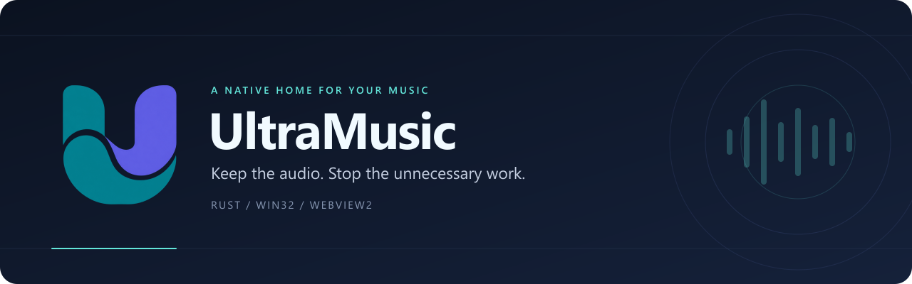

<p align="center">
  
</p>

<h1 align="center">UltraMusic</h1>

<p align="center">
  Un lecteur musical Windows natif, pensé pour rester discret en arrière-plan.<br>
  <strong>Rust · Win32 · Microsoft Edge WebView2</strong>
</p>

<p align="center">
  <a href="https://github.com/Zvenytoh/UltraMusic/actions/workflows/windows.yml"></a>
  <a href="https://www.rust-lang.org/"></a>
  <a href="#installation"></a>
  <a href="LICENSE"></a>
  <a href="#statut-du-projet"></a>
</p>

<p align="center">
  <a href="#installation">Installation</a> ·
  <a href="#utilisation">Utilisation</a> ·
  <a href="docs/ARCHITECTURE.md">Architecture</a> ·
  <a href="CONTRIBUTING.md">Contribuer</a> ·
  <a href="https://github.com/Zvenytoh/UltraMusic/issues">Signaler un problème</a>
</p>

<p align="center">
  <a href="https://github.com/Zvenytoh/UltraMusic/releases/download/v0.1.0/UltraMusic-windows-x64.zip"></a><br>
  <sub>ZIP portable · Version 0.1.0 prototype · Sans compte GitHub</sub>
</p>

---

## Pourquoi UltraMusic ?

Écouter sa musique ne devrait pas nécessiter une interface supplémentaire pleine
d’animations. UltraMusic héberge directement le site officiel de **YouTube Music**
ou d’**Apple Music** dans une fenêtre native Windows, avec une seule WebView et un
profil persistant.

Le principe est simple : conserver le lecteur, masquer l’interface lorsqu’elle
n’est plus utile, et éviter le travail périodique du wrapper. Le moteur WebView2
installé sur Windows est réutilisé ; aucun moteur Chromium n’est embarqué dans
le dépôt ou la distribution de l’application.

> **Keep the audio. Stop the unnecessary work.**
>
> Il s’agit d’un objectif de conception : les gains CPU/GPU restent à mesurer.

## Statut du projet

**Version 0.1.0 — prototype, pas encore un MVP entièrement validé.**

Le code compile et fait l’objet de contrôles statiques. La connexion aux services,
les DRM, la continuité audio en arrière-plan et les commandes multimédias doivent
encore être vérifiés sur des comptes réels. Aucun chiffre de performance n’est
annoncé avant des mesures reproductibles.

| Présent dans le code | À valider ou à développer |
| :--- | :--- |
| Fenêtre native Win32 et WebView2 | Connexion et DRM de chaque service |
| Fermeture et minimisation vers la zone de notification | Lecture prolongée et changements de piste en arrière-plan |
| Restauration de la même WebView, sans rechargement demandé | Comportement des touches multimédias et SMTC |
| Profil local persistant et instance unique | Comparaison CPU/GPU avec Edge PWA, Tauri et Electron |
| Masquage du contrôleur et mode de compatibilité | Validation sur différentes machines et versions du runtime |
| Redémarrage manuel du lecteur et filtrage des liens | Intégration système supplémentaire, selon son coût mesuré |

## Installation

### Prérequis

- **Windows 11 x64** pour la plateforme initiale visée.
- Le runtime **[Microsoft Edge WebView2 Evergreen](https://developer.microsoft.com/microsoft-edge/webview2/)** installé.
- Une connexion Internet et un compte/abonnement lorsque le service le demande.

### Télécharger et lancer

1. **[Télécharger UltraMusic pour Windows](https://github.com/Zvenytoh/UltraMusic/releases/download/v0.1.0/UltraMusic-windows-x64.zip)**.
2. Extraire tous les fichiers du ZIP dans un dossier.
3. Double-cliquer sur **`UltraMusic.exe`**.

Aucune compilation et aucun compte GitHub ne sont nécessaires. Le fichier
`LIRE-MOI.txt` accompagne le lecteur. Il s'agit d'une **préversion prototype** ;
retrouver ses détails sur la [page de téléchargement](https://github.com/Zvenytoh/UltraMusic/releases/tag/v0.1.0).

Les builds de développement restent disponibles dans
[GitHub Actions](https://github.com/Zvenytoh/UltraMusic/actions/workflows/windows.yml).

## Utilisation

```powershell
# YouTube Music, service par défaut
.\ultramusic.exe

# Apple Music — compatibilité du service à valider
.\ultramusic.exe --apple

# Mode de compatibilité : ne pas masquer explicitement le contrôleur WebView2
.\ultramusic.exe --keep-rendering

# Les options peuvent se combiner
.\ultramusic.exe --apple --keep-rendering
```

| Action | Comportement du wrapper |
| :--- | :--- |
| Cliquer sur la croix ou minimiser | Masque la fenêtre dans la zone de notification |
| Double-cliquer sur l’icône | Restaure la fenêtre et la WebView existante |
| Relancer UltraMusic | Demande la restauration de l’instance déjà ouverte |
| Clic droit → **Redémarrer le lecteur** | Recrée la WebView après confirmation ; interrompt la lecture |
| Clic droit → **Compatibilité : conserver le rendu** | Bascule le traitement du rendu lorsque la fenêtre est masquée |
| Clic droit → **Quitter** | Ferme le contrôleur et termine le wrapper |

Pour changer de service, **quitter complètement** UltraMusic puis le relancer avec
l’option souhaitée. Un second lancement ne change pas le service de l’instance
existante. Le réglage de compatibilité du menu n’est pas conservé après la sortie ;
utiliser `--keep-rendering` pour l’activer dès le démarrage.

## Ce que fait le mode arrière-plan

```text
Fenêtre ouverte                 Croix / minimisation
       │                                 │
       ▼                                 ▼
Interface visible               Fenêtre native masquée
WebView2 actif                  Contrôleur masqué par défaut
       ▲                        Aucune suspension de page
       │                                 │
       └──────── Double-clic sur l’icône ─┘
```

UltraMusic utilise `IsVisible = false` sur le contrôleur WebView2, sauf en mode
compatibilité. [Microsoft documente ce comportement](https://learn.microsoft.com/en-us/dotnet/api/microsoft.web.webview2.core.corewebview2controller.isvisible),
mais il ne garantit pas une activité GPU nulle : les sites peuvent continuer leur
JavaScript, leur réseau et le traitement multimédia.

- Aucune boucle active ni timer périodique dans le lecteur Rust.
- Aucun polling du morceau, script permanent, effet CSS injecté ou visualiseur.
- Aucune suspension automatique, même quand le lecteur est en pause.
- Accélération matérielle laissée au réglage du runtime.
- Aucun redémarrage automatique susceptible de créer une boucle de crash.

L’attente de cinq secondes maximum d’un **second processus au démarrage** sert
uniquement à retrouver la première fenêtre. Elle n’ajoute pas de polling au lecteur.

## Compilation

Installer Rust stable avec la cible MSVC, Visual Studio Build Tools avec
**Développement Desktop en C++**, et le SDK Windows.

```powershell
git clone https://github.com/Zvenytoh/UltraMusic.git
cd UltraMusic

cargo build --release --locked
.\target\release\ultramusic.exe
```

### Contrôles de qualité

```powershell
cargo fmt --all -- --check
cargo check --locked
cargo clippy --locked --all-targets -- -D warnings
cargo build --release --locked
```

La CI exécute le contrôle de formatage, Clippy et le build Windows MSVC.
**Aucun test unitaire n’est présent ni exécuté.** Le script fonctionnel
`scripts/smoke.ps1` est conservé pour des vérifications explicitement demandées ;
il n’est pas lancé par la CI et ne valide pas la lecture musicale.

<details>
<summary><strong>Outillage GNU local et scripts PowerShell</strong></summary>

Le script `./scripts/dev.ps1` accepte `check`, `fmt`, `clippy` et `build`. Il utilise
l’outillage local dans `.tools/` lorsqu’il existe, sinon Rust installé sur le système.
Ce dossier d’outils n’est pas distribué dans le dépôt.

```powershell
./scripts/dev.ps1 check
./scripts/dev.ps1 clippy
./scripts/dev.ps1 build
```

Pour le build GNU local, conserver **`WebView2Loader.dll` à côté de l’exécutable**.
Le build MSVC de la CI utilise le loader lié statiquement. Les variables
d’environnement modifiées par le script sont restaurées après son exécution.

</details>

## Organisation du code

```text
UltraMusic/
├── src/
│   ├── main.rs            Point d’entrée
│   ├── config.rs          Configuration et règles de navigation
│   └── native/
│       ├── mod.rs         État de l’application et boucle Win32
│       ├── instance.rs    Instance unique et activation
│       ├── webview.rs     Contrôleur et callbacks WebView2
│       ├── window.rs      Fenêtre, messages et visibilité
│       └── tray.rs        Icône de notification et menu
├── assets/                Logo, bannière et icône Windows
├── docs/                  Architecture, spécification et validation
├── scripts/               Outils de développement
└── .github/workflows/     Compilation et contrôles Windows
```

Les objets COM restent sur le thread UI STA. Des gardes RAII gèrent les ressources
natives, et une génération identifie chaque lecteur pour ignorer les callbacks et
messages devenus obsolètes. Les responsabilités et invariants sont décrits dans
[l’architecture](docs/ARCHITECTURE.md).

## Confidentialité et sécurité

- Authentification auprès des sites officiels ; Rust ne traite pas les mots de passe.
- Profil WebView2 conservé localement dans `%LOCALAPPDATA%\UltraMusic\WebView2`.
- Aucune télémétrie personnalisée ni journal applicatif écrit par le wrapper.
- Aucun objet hôte Rust ni canal de messagerie natif exposé aux pages distantes.
- Navigation principale limitée à des hôtes HTTPS explicites du service et de sa connexion.
- Confirmation avant ouverture d’un lien externe HTTPS initié par l’utilisateur.

Les services musicaux et WebView2 conservent leurs propres comportements réseau
et politiques de confidentialité. UltraMusic ne modifie pas les flux protégés.

<details>
<summary><strong>Effacer la session locale</strong></summary>

Quitter UltraMusic depuis son icône et attendre la fermeture de ses processus
WebView2. Supprimer ensuite **uniquement** `%LOCALAPPDATA%\UltraMusic\WebView2`
dans l’Explorateur. Cela efface les cookies et données du profil partagé par les
deux services et impose une nouvelle connexion.

</details>

## Limites connues

- Les services peuvent refuser les navigateurs intégrés ou imposer des contraintes DRM.
- Les popups autorisés sont redirigés dans la WebView unique. Une connexion qui exige
  un popup distinct et `window.opener` peut échouer.
- Le mode compatibilité conserve `IsVisible = true`, mais Windows et WebView2
  peuvent encore détecter que la fenêtre parente est masquée.
- Les touches multimédias dépendent actuellement du site et du runtime ; aucun
  pont SMTC personnalisé n’est implémenté.
- Une défaillance de sous-processus, même non critique, peut afficher une alerte.

Voir le [protocole de validation](docs/VALIDATION.md) pour les essais audio,
veille/reprise, restauration et benchmarks comparatifs à effectuer.

## Documentation et contribution

| Ressource | Contenu |
| :--- | :--- |
| [Identité visuelle](docs/BRANDING.md) | Logo, formats et utilisation |
| [Architecture](docs/ARCHITECTURE.md) | Modules, durée de vie, événements et frontière de confiance |
| [Spécification](docs/SPECIFICATION.md) | Objectifs et périmètre du projet |
| [Validation](docs/VALIDATION.md) | Scénarios fonctionnels et protocole de mesure |
| [Revue de publication](docs/REVIEW.md) | Corrections et contrôles réellement effectués |
| [Historique du prototype](docs/BUILD-RESULTS.md) | Résultats antérieurs à la réorganisation |
| [Contribuer](CONTRIBUTING.md) | Conventions et préparation des changements |
| [Issues](https://github.com/Zvenytoh/UltraMusic/issues) | Bugs, retours et propositions |

Pour signaler un problème, préciser la version de Windows, le service utilisé,
le mode de rendu et les étapes de reproduction. Ne pas joindre de cookies,
de mots de passe ni de profil WebView2.

## Licence

Distribué sous [licence MIT](LICENSE). Les visuels du projet sont
couverts par cette même licence.

UltraMusic est un projet indépendant, sans affiliation avec Apple, Google,
YouTube ou Microsoft. Les noms des services appartiennent à leurs titulaires.

<p align="center">
  <br>
  <sub>Keep the audio. Stop the unnecessary work.</sub>
</p>
